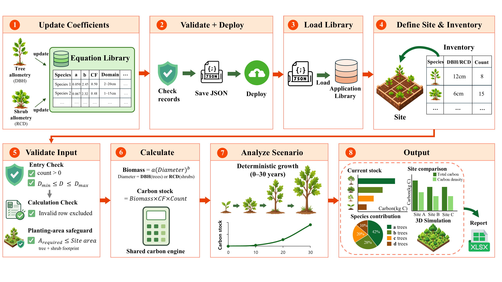
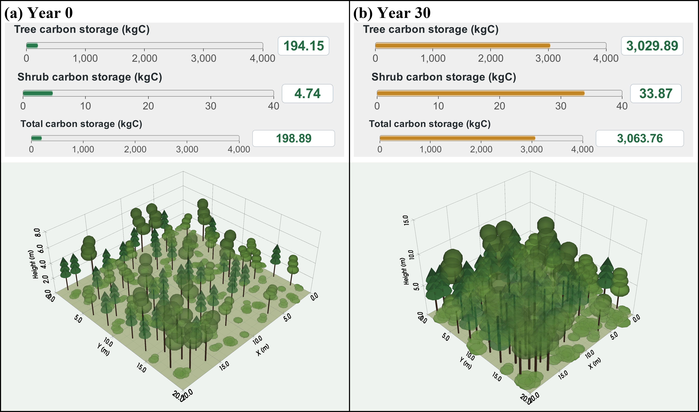
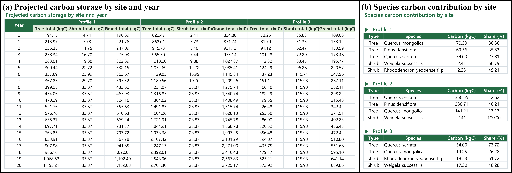

# ForeCarb

**Integrating allometric-equation management, carbon-stock assessment, and growth-scenario analysis for early-stage forest restoration**

**English** · [한국어](README.ko.md)

ForeCarb is an open-source Windows desktop application for assessing live biomass carbon stocks in mixed tree and shrub inventories at forest restoration sites. It combines allometric-equation management, unit-consistent calculation, cross-site comparison, deterministic growth scenarios over a **30-year horizon**, 3D visualization, and XLSX reporting.

This README describes ForeCarb v1.1 and follows the accompanying manuscript. Figures 1–6 and Tables 1–4 match the revised manuscript; installation, build, and repository guidance is provided below.

**Main contributions**

- **Integrated allometric-equation management:** ForeCarb integrates equation-library management with established allometric methods; administrators update equations without altering calculation procedures.
- **Equation library:** The library combines 22 core equation records with 55 additional published records.
- **Site-level carbon-stock estimation:** Validated tree and shrub inventories yield species- and site-level carbon estimates.
- **Site comparison and growth-scenario analysis:** Site comparisons and 30-year deterministic growth scenarios aid restoration planning.

#### Code metadata

| Nr | Description | Value |
|:---:|---|---|
| C1 | Current code version | v1.1 |
| C2 | Permanent link to code/repository used for this code version | https://github.com/ISW-LAB/ForeCarb/tree/v1.1 (equation library: [`species_data.json`](species_data.json)) |
| C3 | Permanent link to Reproducible Capsule | Not applicable |
| C4 | Legal Code License | [MIT](LICENSE); [KOGL Type 1](DATA_LICENSE.md) for `species_data.json` |
| C5 | Code versioning system used | Git |
| C6 | Languages, tools, and services used | Python, PyQt5, NumPy, Matplotlib, openpyxl, Pillow, PyVista/VTK, PyInstaller, Inno Setup |
| C7 | Compilation requirements, OS & dependencies | Microsoft Windows 10/11 (64-bit); Python ≥ 3.10; `pip install -r requirements.txt`; `python main.py --lang en` |
| C8 | Developer documentation/manual | [README.en.md](README.en.md) (English); [README.ko.md](README.ko.md) (Korean); runnable example: [`reproduce_examples.py`](reproduce_examples.py) |
| C9 | Support email | [kc.jeong-isw@cbnu.ac.kr](mailto:kc.jeong-isw@cbnu.ac.kr); [gc.jo-isw@cbnu.ac.kr](mailto:gc.jo-isw@cbnu.ac.kr) |

[1. Architecture](#1-architecture-and-workflow) · [2. Equation library](#2-equation-library) · [3. Calculation](#3-calculation) · [4. Illustrative examples](#4-illustrative-examples) · [Limitations](#limitations-and-future-improvements) · [5. Install](#5-install-and-run) · [6. Edit & deploy](#6-edit-and-deploy-the-equation-library) · [7. Build](#7-build) · [8. Tests](#8-tests) · [9. Layout](#9-repository-layout) · [10. Citation](#10-citation) · [11. License](#11-license)

> [!IMPORTANT]
> **Scope.** Allometric equations define diameter–biomass relationships; diameter development is prescribed separately through annual increments. Trajectories are therefore **deterministic outcomes under the specified growth assumptions** — not validated predictions. Projected diameters are **held at the upper fitted limit** of the selected equation, so no estimate is an extrapolation; growth beyond the fitted range is not represented. The baseline scenario assumes that all planted individuals survive throughout the projection horizon; optional per-species survival rates produce a separate, survival-adjusted result (Section 3). Planting-area footprints and 3D geometry are software-defined settings, not ecological carrying capacity, appropriate planting density, or measured plant architecture. Confirm that the response variable, biomass component, predictor units, and measurement protocol match the intended assessment context.

---

## 1. Architecture and workflow

Python + PyQt5 for Microsoft Windows 10/11. NumPy (computation), Matplotlib (2D plots), openpyxl (XLSX), PyVista/VTK (optional 3D). Korean and English interfaces use the same computational services; the packaged application runs without a separate Python installation.

<p align="center">
  
</p>

> **Figure 1.** Software architecture and eight-stage workflow of ForeCarb from equation-library management (stages 1 to 3) to site assessment (stages 4 to 8).

| Stage | Component | Core content |
|:---:|---|---|
| **1** | Library Manager | Define equations and parameters across four collections — coefficients, carbon fraction, fitted range, three period-specific increments (years 1–10 / 11–20 / 21–30) |
| **2** | Library Manager | Validate identifiers, duplicates, coefficients, range ordering, and expressions → save as JSON |
| **3** | Library Manager | Application loads the validated user library at startup; default release library kept as fallback |
| **4** | Assessment App | Enter site info and species / diameter / represented count. DBH and RCD entered in cm, converted to equation-native units; core-record a/b/CF overrides available |
| **5** | Assessment App | Entry- and calculation-level validation + planting-area safeguard |
| **6** | Assessment App | Shared engine evaluates each accepted record → aggregate by species and site → carbon density |
| **7** | Assessment App | 0–30-year scenarios projected from the stored increments, evaluated by the **same engine** as current stock |
| **8** | Assessment App | 2D plots, optional 3D views, cross-site comparison, XLSX export |

---

## 2. Equation library

The 22 core records were assembled from our earlier studies [[12](#ref-12), [25](#ref-25)–[28](#ref-28)] and are not models newly fitted for this study. They are based on destructive biomass sampling in the Republic of Korea: the shrub records derive from the whole-plant excavation of nursery-grown shrubs [[12](#ref-12), [25](#ref-25)–[27](#ref-27)], and the tree records derive from the sampling of young trees at nurseries and restoration sites, as documented for *Pinus densiflora* at quarry restoration sites [[28](#ref-28)]; for the tree records T02–T07, the source data also include national biomass data for major tree species (source 7 in Table 2). In the source studies, the response variable is the dry weight of the whole individual; each core equation therefore estimates total biomass rather than separate aboveground and belowground components. Tables 1 and 2 list all 22 records; the [provenance ledger](docs/core_equation_provenance.tsv) lists 24 distinct equations, including all three T01 site variants. The diameter increments represent interval averages of the species-specific diameter growth observed in earlier projects of the National Institute of Forest Science (NIFoS); they serve as editable scenario inputs, and the available raw data do not permit an independent reconstruction of all 66 increments.

The entry dialog initially displays the first item, or the first matching item after filtering. This is not a scientific recommendation: the user must select the appropriate named equation ID. Coefficient/CF overrides are available for core tree/shrub records only.

**77 equation records covering 67 distinct scientific names.** The primary tree and shrub collections contain 22 core equation records assembled from our earlier studies; the domestic and international collections contain 55 equations compiled from published studies. Multiple records are retained for a species when source studies differ in geographic origin, stand condition, or biomass component — *Pinus thunbergii*, for example, has **four records**.

All 77 records are selectable in the site-assessment screen. Each record is filed under the tree or shrub input tab by its **predictor variable** — RCD records are shrubs, the rest are trees — which gives **59 tree** and **18 shrub** records.

| Collection | Records | Predictor | Stored form | Assessment | Graph basis |
|---|---:|---|---|:---:|:---:|
| Trees `TREE_BASE` | **7** | DBH (cm) | Coefficients `a, b, CF` + range + increments | ✅ | year · diameter |
| Shrubs `SHRUB_SPECIES` | **15** | RCD (fitted in mm) | Coefficients `a, b, CF` + range + increments | ✅ | year · diameter |
| Domestic `DOMESTIC_SPECIES` | **30** | DBH · RCD (+ height, density) | Expression string + range | ✅ | diameter |
| International `FOREIGN_SPECIES` | **25** | DBH · RCD · height (+ height, LAI, length) | Expression string + range | ✅ | diameter |
| **Total** | **77** | | | **77** | **77 diameter · 22 year** |

#### Table 1. Equations of the 22 core records (IDs as in the software and XLSX reports)

| ID | Scientific name | Allometric equation | Predictor | Range (cm) |
|:---:|---|---|:---:|:---:|
| ***Tree collection*** | | | | |
| T01 | *Pinus densiflora* | `Y = 0.0737·X^2.5735` | DBH | 1–15 |
| T02 | *Pinus thunbergii* | `Y = 0.0679·X^2.5770` | DBH | 1–29 |
| T03 | *Chamaecyparis obtusa* | `Y = 0.3617·X^2.0450` | DBH | 1–50 |
| T04 | *Quercus serrata* | `Y = 0.2002·X^2.3767` | DBH | 1–30 |
| T05 | *Robinia pseudoacacia* | `Y = 0.1391·X^2.5016` | DBH | 1–30 |
| T06 | *Quercus acuta* | `Y = 0.1926·X^2.4300` | DBH | 1–40 |
| T07 | *Quercus mongolica* | `Y = 0.0147·X^3.1075` | DBH | 6–30 |
| ***Shrub collection*** | | | | |
| S01 | *Euonymus japonicus* | `Y = 0.0002·(10X)^2.5` | RCD | 0.6–5.3 |
| S02 | *Rhododendron yedoense* f. *poukhanense* | `Y = 0.0003·(10X)^2.4` | RCD | 0.1–2.2 |
| S03 | *Spiraea prunifolia* | `Y = 0.00025·(10X)^2.6` | RCD | 0.5–4.4 |
| S04 | *Euonymus alatus* | `Y = 0.000022·(10X)^2.55` | RCD | 1.1–6.7 |
| S05 | *Buxus sinica* var. *insularis* | `Y = 0.000018·(10X)^2.7` | RCD | 0.8–3.0 |
| S06 | *Forsythia koreana* | `Y = 0.00028·(10X)^2.45` | RCD | 0.4–2.6 |
| S07 | *Nandina domestica* | `Y = 0.00031·(10X)^2.3` | RCD | 0.4–3.5 |
| S08 | *Viburnum erosum* | `Y = 0.00026·(10X)^2.5` | RCD | 0.7–3.9 |
| S09 | *Deutzia parviflora* | `Y = 0.00023·(10X)^2.6` | RCD | 0.4–2.5 |
| S10 | *Weigela subsessilis* | `Y = 0.00029·(10X)^2.4` | RCD | 0.6–3.9 |
| S11 | *Lespedeza bicolor* | `Y = 0.00015·(10X)^2.8` | RCD | 0.2–1.7 |
| S12 | *Syringa oblata* var. *dilatata* | `Y = 0.00005·(10X)^2.64` | RCD | 0.5–2.9 |
| S13 | *Callicarpa dichotoma* | `Y = 0.0021·(10X)^2.65` | RCD | 0.7–2.5 |
| S14 | *Ligustrum obtusifolium* | `Y = 0.00019·(10X)^2.75` | RCD | 0.4–3.5 |
| S15 | *Cornus alba* | `Y = 0.00027·(10X)^2.52` | RCD | 0.7–5.2 |

<sub>`X`: DBH or RCD (cm); `Y`: total individual biomass (kg).</sub>

#### Table 2. Inputs and sources of the 22 core records

| ID | Scientific name | CF | g1 / g2 / g3 | Sources |
|:---:|---|:---:|:---:|:---:|
| T01 | *Pinus densiflora* | 0.50 | 0.11 / 0.20 / 0.70 | 2, 4 |
| T02 | *Pinus thunbergii* | 0.50 | 0.24 / 0.32 / 0.32 | 2, 7 |
| T03 | *Chamaecyparis obtusa* | 0.50 | 0.11 / 0.23 / 0.23 | 2, 7 |
| T04 | *Quercus serrata* | 0.50 | 0.13 / 0.30 / 0.30 | 2, 7 |
| T05 | *Robinia pseudoacacia* | 0.50 | 0.14 / 0.20 / 0.20 | 2, 7 |
| T06 | *Quercus acuta* | 0.50 | 0.12 / 0.16 / 0.16 | 2, 7 |
| T07 | *Quercus mongolica* | 0.50 | 0.40 / 0.40 / 0.40 | 4, 7 |
| S01 | *Euonymus japonicus* | 0.50 | 0.30 / 0.22 / 0.22 | 6 |
| S02 | *Rhododendron yedoense* f. *poukhanense* | 0.50 | 0.31 / 0.17 / 0.17 | 6 |
| S03 | *Spiraea prunifolia* | 0.50 | 0.20 / 0.14 / 0.14 | 6 |
| S04 | *Euonymus alatus* | 0.50 | 0.38 / 0.25 / 0.25 | 6 |
| S05 | *Buxus sinica* var. *insularis* | 0.50 | 0.24 / 0.17 / 0.17 | 6 |
| S06 | *Forsythia koreana* | 0.50 | 0.16 / 0.16 / 0.16 | 3 |
| S07 | *Nandina domestica* | 0.50 | 0.24 / 0.22 / 0.22 | 5 |
| S08 | *Viburnum erosum* | 0.50 | 0.35 / 0.00 / 0.00 | 2 |
| S09 | *Deutzia parviflora* | 0.50 | 0.30 / 0.00 / 0.00 | 2 |
| S10 | *Weigela subsessilis* | 0.50 | 0.30 / 0.24 / 0.24 | 5 |
| S11 | *Lespedeza bicolor* | 0.50 | 0.10 / 0.06 / 0.06 | 2 |
| S12 | *Syringa oblata* var. *dilatata* | 0.45 | 0.25 / 0.23 / 0.23 | 3 |
| S13 | *Callicarpa dichotoma* | 0.50 | 0.24 / 0.16 / 0.16 | 5 |
| S14 | *Ligustrum obtusifolium* | 0.50 | 0.18 / 0.21 / 0.21 | 5 |
| S15 | *Cornus alba* | 0.50 | 0.29 / 0.26 / 0.26 | 5 |

<sub>CF: carbon fraction; `g1 / g2 / g3`: diameter increments (cm/year) in the three decades. The CF values are software defaults, and the increments are editable scenario inputs based on project measurements.</sub>

Sources: 1 and 4, tree data from restoration sites (NIFoS); 2, nursery data for young trees and shrubs (NIFoS); 3, shrub study [[27](#ref-27)]; 5, shrub study [[26](#ref-26)]; 6, shrub study [[25](#ref-25)]; 7, national biomass data for major tree species. NIFoS denotes project data of the National Institute of Forest Science. T01 additionally has artificial-restoration (`0.0722·X^2.6044`, 1–22 cm; sources 2 and 4) and quarry (`0.1323·X^2.2619`, 1–25 cm; sources 1 and 2) variants. Bibliographic details appear in [Equation sources](#equation-sources).

- `g1 / g2 / g3`: annual diameter increment (cm yr⁻¹) in years 1–10, 11–20, and 21–30. **Zero = no prescribed growth** in that period.
- `X` = DBH for trees, RCD for shrubs, in cm. Shrub equations fitted in mm are written as **`10X`**, with fitted limits converted to cm — the original relationship is preserved without refitting.
- **Every species stores one record per site category**, and the application applies exactly the record for the selected category — there is no category-independent base equation (`SiteCategoryTests`). All four collections use the same `by_env` shape, keyed by the three categories.
- Records that the sources actually differentiate carry different values: *Pinus densiflora* uses sheet rows 1 / 2 / 3 for the three categories. Every other species is initialized identically across the three and can be differentiated in the Manager as evidence becomes available.
- **Growth factors** are applied on top of the selected record's annual diameter increments: nine factors, **three site categories × growth tiers 1–3** (default `1.0` = no adjustment). Each species is assigned a tier per category (default tier 1), and records without stored increments scale their assumed 2 % rate by the same factor. An optional per-species override takes precedence. The factors scale the 30-year scenario only; the equation is untouched, so year-0 stock does not move. Older files with one tree and one shrub factor per category are read as tiers 1 and 2.
- **Equation IDs.** Each record has an ID made of its collection letter (`T` tree, `S` shrub, `D` domestic, `I` international) and its position in the library: `T01`–`T07`, `S01`–`S15`, `D01`–`D30`, `I01`–`I25` (for example `T01` *Pinus densiflora*, `S10` *Weigela subsessilis*, `D21`–`D23` the three compiled *Pinus thunbergii* records). The entry dialog shows the ID and the XLSX report records it for every inventory record.
- Full inventory: [`species_data.json`](species_data.json).

#### Graph bases

The estimation panel plots carbon stock against either axis, selected per tab:

- **By year** — the 0–30-year deterministic scenario for the **22 primary tree and shrub records**, using stored period-specific diameter increments. The 55 domestic and international records have no stored increments and instead use an assumed 2% annual increase of the first predictor for exploratory scenarios.
- **By diameter** — carbon across the predictor axis, available for **all 77** records. Each curve spans that record's fitted range; the **20** records whose sources publish no domain are swept over a band around the entered value and flagged as such. Curves are not summed on this basis because records have different domains.

Records from the extension collections contribute to the site totals, the planting-area guard (whose per-individual areas are defined per growth form, not per species), and the Excel export. Each result table also reports the core and extension subtotals separately, so the 22-record figures remain readable. The manuscript's 3D growth examples use the same prescribed diameter increments as the primary year-based scenarios.

---

## 3. Calculation

```
B_i(t)    = a_i · [ q_i · D_i(t) ]^b_i
C_i(t)    = B_i(t) · CF_i · n_i                                        … Eq. (1)
C_site(t) = Σ C_i(t)        for i ∈ V (records retained after validation)

A_required = α_tree · Σ n_i(trees) + α_shrub · Σ n_i(shrubs)           … Eq. (2)
             defaults α_tree = 1.00 m², α_shrub = 0.25 m² per individual
             → calculation halts when A_required > A_site

ρ_C(t) = C_site(t) / A_site                                            … Eq. (3)

D_i(t) = D_i(0) + Σ_{s=1..t} g_i,p(s)                                  … Eq. (4)
         p(s) = 1 (1–10 yr) · 2 (11–20 yr) · 3 (21–30 yr)

v_i(t) = 1 if D_min,i ≤ D_i(t) ≤ D_max,i, else 0                       … Eq. (5)
```

| Symbol | Meaning |
|---|---|
| `D_i(t)` | DBH or RCD **in cm** at year `t`; current stock at `t = 0` |
| `q_i` | Predictor scaling — `1` for cm-based tree equations, `10` for mm-based shrub equations |
| `n_i`, `CF_i` | Represented count; record-level carbon fraction (including overrides) |
| `v_i(t) = 0` | Audit flag — record **held at the upper fitted limit** (growth stopped) |

- Eq. (1) aggregates records **individually**, so the site total preserves the power law's nonlinearity.
- `q_i` belongs to the equation record, so overrides (`a_i`, `b_i`, `CF_i`) never change it.
- Eq. (3): total stock is **independent of site area**; density varies **inversely** with it.
- Eq. (2): `α_tree` and `α_shrub` are user settings (**Settings → Planting-area safeguard**; kept for later sessions and written to the report). The defaults correspond to a spacing of 1 m × 1 m and 0.5 m × 0.5 m. They only decide whether the calculation proceeds and never enter the biomass or carbon calculation.
- Growth stops at the upper fitted limit: `D_i(t) = min(D_i(t−1) + g_i, D_max,i)`, so every estimate is evaluated within the fitted range. The year-based plots show the resulting trajectories. Eq. (5) flags the records held at that limit in the XLSX report, which records the first year each record reaches its upper limit (`Calculation_details`) and the stock and share held at the limit for every year (`Fitted_range_audit`). Records whose source publishes no fitted range grow for the whole period and are reported as not auditable.
- Domestic/international records use `Y_i = f_i(X_i, H_i)` via an AST allowlist (no Python `eval`). Storing no carbon fraction or increments, they apply a fixed **CF₀ = 0.5** and use an assumed 2% annual increase of the first predictor for exploratory scenarios. This is not a measured species-specific growth rate; see [GROWTH_ASSUMPTIONS.md](GROWTH_ASSUMPTIONS.md).

#### Survival-adjusted results (optional)

```
N_i(t)   = n_i · S0_i · s_i^t                                          … Eq. (6)
C_i^S(t) = C_i(t) · S0_i · s_i^t
```

- `S0_i` is the **initial survival** (%) applied to the year-0 count, as in the earlier MATLAB carbon calculator; `s_i` is the **annual survival** (%) compounded each year. Both default to 100 %, which reproduces the baseline exactly.
- Carbon scales linearly with the represented count, so Eq. (6) rescales the baseline trajectory without changing diameters or equations.
- Survival-adjusted values are reported **alongside** the all-survive baseline, never in place of it: the stock gauges draw them as a dark inner bar, the **With survival** view plots solid (all survive) against dashed (with survival) curves next to a survival-based contribution chart, and XLSX exports add a `생존률_반영` sheet. The 3D view and cross-site comparison use the baseline.

---

## 4. Illustrative examples

These examples illustrate **software behavior under the tested settings**, not agreement with independent field observations.

### 4.1 Equation-library configuration and deployment

<p align="center">
  
</p>

> **Figure 2.** Equation-library configuration and deployment in ForeCarb.

The manager maintains records from four collections. Figure 2 shows the interface organized by restoration-site category, with tree and shrub subtabs and editable columns for coefficients, carbon fractions, fitted limits, and growth increments.

**(a)** add a record · **(b)** remove a record · **(c)** modify regression coefficients · **(d)** deploy the validated JSON — by rebuilding the application or applying it to an existing installation.

### 4.2 Integrated assessment of mixed tree and shrub inventories

<p align="center">
  
</p>

> **Figure 3.** Integrated assessment of Profile 1, including mixed tree and shrub inventories, carbon-stock analysis, and 3D visualization. (a) Dashboard with the year slider set to year 0, which displays the initial stock of 198.89 kg C (Table 3); (b) entry dialog with the selected equation and its parameters; (c) 3D view of the stand at year 0.

Profile 1 demonstrates the integrated assessment of three tree and two shrub species on a 20 m × 20 m site. Table 3 lists the inputs and results of this profile together with the equation ID of each record. The site category is a post-fire site with natural restoration, the CF is 0.50, and the growth increments follow Table 2.

In the dashboard (Figure 3a), the **year slider** (years 0–30) selects the year to be displayed. The horizontal bars and values at the top give the tree, shrub, and total carbon stocks of that year, the dashed vertical line marks the year on the trajectory plot, and the pie chart gives the species contributions in that year; the light part of each bar shows the stock with all individuals surviving, and the dark part shows the survival-adjusted stock. Because the slider is set to year 0, the values at the top equal the year-0 stocks listed in the result tables below the plots (198.89 kg C in total); when another year is selected, the values at the top change, whereas the result tables continue to list the year-0 stocks calculated from the measured diameters. The entry dialog (Figure 3b) displays the equation ID, the selected equation, its fitted range, and its diameter increments, and the coefficients and CF can be edited for the record. The 3D view (Figure 3c) follows the same slider and is shown for year 0.

### 4.3 Area-aware cross-site comparison

Designed to separate variation from **inventory composition** from that introduced by **area normalization**.

#### Table 3. Controlled inventories and outputs for the cross-site comparisons in Figure 4

| Comparison | Profile | Site area (m²) | ID | Record | D (cm) | n | C(0) (kg C) | C(30) (kg C) | Density (kg C m⁻²) |
|---|:---:|:---:|:---:|---|---:|---:|---:|---:|---:|
| **(1) Common area** | 1 | 400 | T01 | *Pinus densiflora* | 5.0 | 30 | 69.56 | 1,175.52 | |
|  |  |  | T04 | *Quercus serrata* | 4.0 | 20 | 54.00 | 637.26 | |
|  |  |  | T07 | *Quercus mongolica* | 8.0 | 15 | 70.59 | 1,217.11 | |
|  |  |  | S02 | *Rhododendron yedoense* f. *poukhanense* | 1.2 | 40 | 2.33 | 10.00 | |
|  |  |  | S10 | *Weigela subsessilis* | 1.5 | 25 | 2.41 | 23.87 | |
| | | | | **Site total** | | | **198.89** | **3,063.76** | 0.4972 |
|  | 2 | 400 | T01 | *Pinus densiflora* | 7.0 | 60 | 330.71 | 2,351.04 | |
|  |  |  | T04 | *Quercus serrata* | 8.0 | 25 | 350.55 | 1,636.93 | |
|  |  |  | T07 | *Quercus mongolica* | 10.0 | 15 | 141.21 | 1,636.65 | |
|  |  |  | S10 | *Weigela subsessilis* | 1.5 | 25 | 2.41 | 23.87 | |
| | | | | **Site total** | | | **824.88** | **5,648.49** | 2.0622 |
|  | 3 | 400 | T04 | *Quercus serrata* | 4.0 | 20 | 54.00 | 637.26 | |
|  |  |  | T07 | *Quercus mongolica* | 6.0 | 10 | 19.25 | 584.85 | |
|  |  |  | S02 | *Rhododendron yedoense* f. *poukhanense* | 1.8 | 120 | 18.53 | 30.00 | |
|  |  |  | S10 | *Weigela subsessilis* | 2.0 | 90 | 17.30 | 85.93 | |
| | | | | **Site total** | | | **109.08** | **1,338.04** | 0.2727 |
| **(2) Common inventory** | 1 | 400 | | Inventory of Profile 1 | | | 198.89 | 3,063.76 | **0.4972** |
|  | 2 | 500 | | Inventory of Profile 1 | | | 198.89 | 3,063.76 | **0.3978** |
|  | 3 | 600 | | Inventory of Profile 1 | | | 198.89 | 3,063.76 | **0.3315** |

<sub>ID: equation ID; `D`: tree DBH or shrub RCD at year 0; `n`: represented count; `C(0)` and `C(30)`: carbon stocks at years 0 and 30 (CF 0.50). The density refers to year 0.</sub>

<p align="center">
  
</p>

> **Figure 4.** Cross-site comparison of total carbon stock and area-normalized carbon density under common-area and common-inventory settings.

- **(a) Common area** — holding site area at 400 m² isolates inventory composition: **109.08 → 824.88 kg C** across the three inventories, reflecting differences in species composition, initial diameter, and represented count.
- **(b) Common inventory** — applying Profile 1 to 400 / 500 / 600 m² isolates site area: total stock **stays 198.89 kg C**, density falls **0.4972 → 0.3978 → 0.3315 kg C m⁻²**.

### 4.4 Deterministic growth scenario visualization

The scenario illustrates how prescribed diameter increments translate into changes in carbon stock. For Profile 1, total stock increases from **198.89 kg C at year 0** to **3,063.76 kg C at year 30** (Figure 5).

<p align="center">
  
</p>

> **Figure 5.** Deterministic growth scenario for Profile 1 at (a) year 0 and (b) year 30 with corresponding 3D stand visualizations. The 3D stands are simulated: their geometry is defined by the software and does not represent observed growth. The diameters stop growing at the upper fitted limits of the equations, so that the stocks shown contain no extrapolation.

| Year | Trees (kg C) | Shrubs (kg C) | **Total (kg C)** | Share held at upper limit |
|:---:|---:|---:|---:|---:|
| 0 | 194.15 | 4.74 | **198.89** | 0.0 % |
| 15 | 763.85 | 33.87 | **797.72** | 4.2 % |
| 30 | 3,029.89 | 33.87 | **3,063.76** | 39.5 % |

**Growth stops at the upper fitted limits.** Initial-diameter validation applies only to year 0, so projected diameters would eventually leave the fitted ranges. ForeCarb therefore holds each diameter at the upper fitted limit of its equation. In Profile 1, three records reach these limits: *Rhododendron yedoense* f. *poukhanense* (S02) in year 4 (2.2 cm), *Weigela subsessilis* (S10) in year 9 (3.9 cm), and *Pinus densiflora* (T01) in year 30 (15 cm), and their stocks remain constant thereafter. In Profile 2, the limits are reached by S10 in year 9 and by T01 in year 28, and in Profile 3, by S02 in year 2 and by S10 in year 7; the annual audit in the XLSX report records them and their share of the stock. Its size, and what it means for long-horizon totals, is discussed under [Limitations and future improvements](#limitations-and-future-improvements). The 3D views are software-defined scenario geometry, not measured plant architecture.

### 4.5 Two-level record validation and planting-area safeguard

#### Table 4. Test cases and outcomes for diameter-range validation and the planting-area safeguard

| Check | Test case | Criterion | Outcome |
|---|---|---|---|
| ***(a) Diameter-range validation*** | | | |
| Tree entry | *P. densiflora*, DBH = 20 cm | Fitted range: 1–15 cm | **Rejected** |
| Shrub entry | *W. subsessilis*, RCD = 5.0 cm | Fitted range: 0.6–3.9 cm | **Rejected** |
| Fitted limits | DBH = 1.00 or 15.00 cm | Limits inclusive | **Accepted** |
| Outside limits | DBH = 0.99 or 15.01 cm | Outside fitted range | **Rejected** |
| Calculation level | Out-of-range record bypassing entry validation | Fitted-range check | **Excluded before calculation** |
| ***(b) Planting-area safeguard (A_site = 100 m²)*** | | | |
| Area exceeded | `A_required = 105.00 m²` | `A_required > A_site` | **Calculation halted** |
| Area boundary | `A_required = 100.00 m²` | `A_required = A_site` | **Accepted** |

Values outside the fitted ranges were rejected and values at the limits accepted; records bypassing the entry check were excluded during calculation; the area safeguard halted calculation only when the requirement **exceeded** the site area.


### 4.6 Result reporting

<p align="center">
  
</p>

> **Figure 6.** Example XLSX output showing site-level carbon-stock projections and species-level carbon contributions. The calculation details and the annual fitted-range audit described below are stored in separate worksheets of the same report.

**(a)** tree, shrub and total stocks per profile and year · **(b)** species-level stocks and shares. Additional worksheets hold site-comparison results and associated figures.

Two further worksheets document how each value was obtained. **`Calculation_details`** lists, for every accepted inventory record, the equation ID, collection, library key, equation applied, predictor and input value, predictor scaling `q`, secondary input, biomass per individual, `CF`, count, carbon stock, any user change to `a`, `b` or `CF` (library value → value used), the fitted range, the growth setting, the first year at the upper fitted limit and the status at year 30; records excluded from the calculation are listed with the reason, and the header gives the software version, the content fingerprint (SHA-256) of the equation library, the site and the planting areas used by the safeguard. **`Fitted_range_audit`** gives, for every year, the totals, the stock of the records held at the upper fitted limit, its share, and the flag `v_i(t)` of each record.

---

## Limitations and future improvements

This section follows the Discussion of the manuscript.

**Limitations**

- **Uniform carbon fraction.** Applying a uniform CF of 0.50 to trees and shrubs ignores variation among species and plant components; for example, carbon concentrations of 45.6–48.7 % were measured in the components of *Grevillea robusta*, close to the IPCC default of 0.47. Replacing 0.50 with 0.47 reduces the affected estimates by 6 % (record S12 uses 0.45).
- **Fixed growth intervals.** Fixed 10-year increments can obscure rapid early growth and nonlinear age effects in shrubs.
- **Multi-stem shrubs.** Equations based only on RCD omit the number of stems and may therefore miss biomass differences between multi-stem individuals of similar diameter.
- **Fitted ranges.** Growth is stopped at the upper fitted limits to avoid extrapolation; without this limit, 46.2 % of the year-30 stock of Profile 1 would be extrapolated. Records held at a limit contribute constant stocks, so that later totals are conservative: in Profile 1, such records account for **4.2 %** of the stock at year 15 and **39.5 %** at year 30 (1,209.39 of 3,063.76 kg C; 38.8 % for trees and 100 % for shrubs), which limits the interpretation of long-horizon totals.
- **Uncertainty.** Uncertainties in the allometric equations, carbon fractions, and growth increments are not propagated, so the trajectories are conditional scenarios rather than estimates with confidence intervals.

**Future improvements.** Future versions will replace the piecewise-constant increments with flexible age-dependent growth functions fitted to repeated measurements, so that rapid early growth is represented. Species-specific parameters, including measured carbon fractions, survival rates, and planting densities, will be stored with the equation records as data become available. Uncertainty in the allometric equations, carbon fractions, and growth inputs will be propagated to interval estimates, and the projections will be compared with independent field inventories of restoration sites.

---

## 5. Install and run

| Executable | Role |
|---|---|
| `ForeCarb.exe` | **Assessment Application** — site assessment, comparison, scenarios |
| `ForeCarb-Equation-Library-Manager.exe` | **Equation Library Manager** — equation editing, validation, deployment |

The installer bundles both programs and Python. Revision 1.1 binaries have not yet been rebuilt; the expected installer output is `FORECAST-SW_Setup_1.1.exe`. From source:

```powershell
pip install -r requirements.txt
python main.py              # language-selection dialog
python main.py --lang en    # English
python main.py --lang ko    # Korean
```

### Load and save input data

Inventories can be entered from an Excel workbook instead of adding species one by one.

| Menu | Action |
|---|---|
| **File → Load data** (`Ctrl+O`) | Creates one tab per site in the workbook and calculates immediately |
| **File → Save data** (`Ctrl+S`) | Writes the inputs of the open sites in the same format (example data if no site is open) |
| **Load data** button on a site tab | Fills only that tab from the workbook |

| Sheet | Columns |
|---|---|
| `지역` (Regions) | site name · width (m) · length (m) · site category · latitude · longitude (optional, decimal degrees) |
| `수종` (Species) | site name · type (tree/shrub) · species · diameter (cm) · count · initial survival (%) · annual survival (%) · second variable |

Korean or English headers and Korean or scientific species names are accepted; blank survival cells mean 100 %. Rows with unknown species or invalid values are skipped and listed after loading. [`presets/ForeCarb_데이터_예시.xlsx`](presets/ForeCarb_데이터_예시.xlsx) reproduces Profiles 1–3 of Table 3 and adds a survival example. User-edited coefficients (`a, b, CF`) are not stored in the workbook.

### Reproduce the manuscript examples

```powershell
python reproduce_examples.py                 # run Profiles 1–3 and check them
python reproduce_examples.py --out reports   # also write one XLSX report per site
python reproduce_examples.py --workbook my_sites.xlsx --no-check
```

The script loads the example workbook [`presets/ForeCarb_데이터_예시.xlsx`](presets/ForeCarb_데이터_예시.xlsx), runs every site through the application code path without opening the GUI (only the 3D renderer is replaced by a stub), prints the stocks at years 0, 15 and 30 with the fitted-range audit, and compares them with [`presets/expected_profiles.json`](presets/expected_profiles.json). It exits with status 0 when all values agree. The report that ForeCarb writes for Profile 1 is provided as [`presets/example_report_Profile_1.xlsx`](presets/example_report_Profile_1.xlsx). Expected totals for Profile 1 (site 20 m × 20 m, site category *post-fire site, natural restoration*):

| Year | Trees (kg C) | Shrubs (kg C) | Total (kg C) | At upper limit (kg C) | Share |
|:---:|---:|---:|---:|---:|---:|
| 0 | 194.15 | 4.74 | **198.89** | 0.00 | 0.0 % |
| 15 | 763.85 | 33.87 | **797.72** | 33.87 | 4.2 % |
| 30 | 3,029.89 | 33.87 | **3,063.76** | 1,209.39 | 39.5 % |

---

## 6. Edit and deploy the equation library

The Manager opens `species_data.json` as editable tables (Figure 2), with validation before saving and an automatic `.bak` backup. It bundles the full core source, so it runs standalone.

Tables are organized by site category — **one tab per category** (post-fire natural, post-fire artificial, quarry artificial), each split into **tree** and **shrub**:

- Each table lists **every species of that growth form** — 59 trees and 18 shrubs — with the coefficient columns (`a, b, CF`, range, growth increments) and the equation columns (equation string, range, variables) merged into one grid. Columns that do not apply to a row are empty and cannot be edited, and a **type** column marks each row as core, domestic or international.
- Values are edited per category: the same species is adjusted independently on each of the three tabs.
- Adding or deleting a species applies to all three categories at once, so every species always has exactly one record per category.
- **Growth factor** inputs sit at the top of each category tab, one per growth tier (tier 1, 2, 3; default `1.0`). The **growth tier** column of the table shows and sets each species' tier for that category; the species' growth increments are multiplied by its tier's factor.

| Method | Description | Python required |
|---|---|:---:|
| **Rebuild the executable** | Rebuild `ForeCarb.exe` from the new `species_data.json` | 3.10+ |
| **Apply the JSON** | Copy `species_data.json` next to the existing `ForeCarb.exe` | No |

> When adding a species, fill in the scientific-name column so English mode displays it.

UI strings follow the same pattern: [`translations_ko_en.json`](translations_ko_en.json) holds every Korean-source → English string used by the interface. Edit the English column and restart — no rebuild required; place the edited file next to a deployed `ForeCarb.exe` to update it the same way.

---

## 7. Build

```powershell
python build_exe.py                  # onefile (default) · --onedir · --debug
python build_exe.py --clean-cache    # remove build/ and dist/ first
python build_exe.py --rebuild-venv   # force-recreate the build venv
python build_updater.py              # Equation Library Manager (or build_library_manager.bat)
```

`pyinstaller` need not be installed separately — the scripts create a dedicated venv (`~\.carboncalc_build_venv`); only the first build takes a few minutes. `species_data.json` is bundled automatically.

**Installer (optional):** `build_exe.py --onedir` → `build_updater.py` → compile `installer.iss` with [Inno Setup 6](https://jrsoftware.org/isdl.php) → `installer_output\FORECAST-SW_Setup_1.1.exe`.

---

## 8. Tests

```powershell
python -m unittest discover -s tests -v
```

22 regression tests reproduce Tables 3–4 and Figures 4–5: library record counts, area-normalized densities (`0.4972 / 0.3978 / 0.3315`), proportional scaling with represented count, diameter boundaries, scenario repeatability and year-zero agreement, shrub mm↔cm equivalence, execution of all 55 compatibility equations, and rejection of unsafe syntax. `tests/test_survival_preset.py` covers survival-adjusted projections (Eq. 6), the data workbook round trip, and the survival worksheet in XLSX exports. The same suite runs in CI on Windows with Python 3.10 and 3.11. `tests/test_fitted_range_audit.py` covers the upper growth limit and the fitted-range audit (Eq. 5), the share held at the upper limits and the years in which the Profile 1 records reach them, the plain year plots, equation IDs, the `Calculation_details` and `Fitted_range_audit` worksheets, the planting-area settings, and the reproduction of the bundled example workbook. Build environment and checksums: [BUILD_VERIFICATION.md](BUILD_VERIFICATION.md).

---

## 9. Repository layout

```
├── main.py                        ← entry point
├── reproduce_examples.py          ← headless reproduction of the manuscript examples
├── species_data.json              ← equation library (77 records) — Tables 1–2
├── translations_ko_en.json        ← UI Korean→English strings (JSON override, no rebuild)
├── build_exe.py / build_updater.py / build_library_manager.bat
├── updater_app.py                 ← Equation Library Manager — Figure 2, stages 1–3
├── installer.iss                  ← Inno Setup installer script
├── carbon_calculator/
│   ├── calculations.py                calculation engine — Eq. (1), (3), stage 6
│   ├── input_limits.py                planting-area safeguard — Eq. (2), stage 5 (user settings)
│   ├── extrapolation.py               upper growth limit and fitted-range audit — Eq. (5)
│   ├── survival.py                    survival-adjusted counts and stocks — Eq. (6)
│   ├── preset_io.py                   Excel data load/save (Regions + Species sheets)
│   ├── equation_eval.py               expression evaluation (AST allowlist)
│   ├── data.py / data2.py             coefficients and equations (JSON-load fallback)
│   ├── species_library.py             unified 77-record view (growth form, graph bases)
│   ├── main_window.py                 site assessment — Figure 3, stages 4–7
│   ├── combined_window.py             integrated window, per-site tabs — Figure 4
│   ├── tree_simulation/               3D growth visualization — Figure 5
│   ├── excel_export.py                XLSX export — Figure 6, stage 8
│   ├── main_window2.py                domestic/international screen (not exposed in v1.0)
│   ├── plotting.py / widgets.py / i18n.py / translations.py
│   └── theme.py / font_config.py / ui_scale.py / qt_locale.py
├── presets/                       ← example input workbooks and expected values
├── docs/                          ← user manual (Korean, PDF)
├── tests/test_core.py             ← 22 regression tests — Tables 3–4
├── tests/test_survival_preset.py  ← survival and data workbook tests
├── tests/test_fitted_range_audit.py ← fitted-range audit, report details, settings, reproduction
└── figures/paper/                 ← Figures 1–6 from the accompanying manuscript
```

**Troubleshooting** — missing PyQt5: `pip install -r requirements.txt` · PyInstaller build error: `--rebuild-venv` · exe exits at launch: rebuild with `--debug` and read the console · broken Korean glyphs: install "Malgun Gothic" · text too large/small: adjust `FONT_SIZE_DELTA` in `carbon_calculator\font_config.py`.

---

## 10. Citation

> Jeong, K., Jo, G., Kim, J., Kim, H.-K., Kim, C.-B., Im, S., Park, K. H., & Lee, E.
> *ForeCarb: Integrating allometric-equation management, carbon-stock assessment, and growth-scenario analysis for early-stage forest restoration.* Accompanying manuscript.

Machine-readable metadata: [`CITATION.cff`](CITATION.cff). **When using an individual allometric equation, also cite its original source publication.**

### Equation sources

Reference numbers follow the bibliography of the revised manuscript; source keys are those of Table 2. Sources 1, 2, 4 and 7 are project data of the National Institute of Forest Science and national biomass data without a separate publication.

- <a id="ref-12"></a>**[12]** Kim, H.-K., Lee, S., Jung, J.-W., Chae, S.-M., Kwon, J.-O., Kwon, Y.-J., & Kim, C.-B. (2026). Optimizing allometric equations for estimating carbon storage of urban shrubs: A morphology-driven machine learning approach and development of an intelligent decision-support system. *Forests*, 17(8), 936.
- <a id="ref-25"></a>**[25]** (source key 6) Kim, H.-K., Kim, H.-S., Hong, Y.-S., Yoon, Y.-S., Lim, Y.-K., Kang, S.-G., & Kim, C.-B. (2022). Sequestration factors development and comparison of carbon storage and uptake by shrubs for urban forests and gardens: *Buxus sinica*, *Euonymus alatus*, *Euonymus japonicus*, *Rhododendron yedoense* and *Spiraea prunifolia*. *Journal of Korean Institute of Forest Recreation and Welfare*, 26(4), 131–139 (in Korean). https://doi.org/10.34272/forest.2022.26.4.011
- <a id="ref-26"></a>**[26]** (source key 5) Kim, H.-K., Kim, H.-S., Kwon, K.-W., Moon, H.-J., Kim, S.-H., Hyung, S.-J., Jin, B.-C., & Kim, C.-B. (2024). Development of shrub carbon sequestration factors to improve forest welfare services in gardens and urban forests: *Nandina domestica*, *Weigela subsessilis*, *Callicarpa dichotoma*, *Ligustrum obtusifolium*, *Cornus alba*. *Journal of Korean Institute of Forest Recreation and Welfare*, 28(1), 13–28 (in Korean). https://doi.org/10.34272/forest.2024.28.1.002
- <a id="ref-27"></a>**[27]** (source key 3) Kim, H.-K., Lee, J., Kang, J., Choi, D., Kang, J., Hwang, Y., Park, D., Pi, J., Kwon, Y., Jin, B., & Kim, C.-B. (2024). Development of allometric equations for carbon storage analysis of shrubs in settlement: *Forsythia koreana* and *Syringa oblata* var. *dilatata* in Sejong-si. *Journal of Environmental Impact Assessment*, 33(6), 422–430 (in Korean). https://doi.org/10.14249/eia.2024.33.6.422
- <a id="ref-28"></a>**[28]** Im, S., & Park, K.-H. (2025). Development of allometric equations of young *Pinus densiflora* in post-mining forest restoration sites. *Journal of Korean Society of Forest Science*, 114(4), 403–415 (in Korean). https://doi.org/10.14578/jkfs.2025.114.4.403

**Contact**: [kc.jeong-isw@cbnu.ac.kr](mailto:kc.jeong-isw@cbnu.ac.kr) · [gc.jo-isw@cbnu.ac.kr](mailto:gc.jo-isw@cbnu.ac.kr)

---

## 11. License

| Scope | License |
|---|---|
| Source code, build scripts, documentation, repository figures | [MIT License](LICENSE) |
| Scientific equation library in `species_data.json` | [KOGL Type 1 (Attribution)](DATA_LICENSE.md) |

Individual allometric equations must retain the bibliographic information of their original sources — see [DATA_LICENSE.md](DATA_LICENSE.md).

---

<sub>Supported by IPET (RS-2024-00398561, MAFRA), IITP (IITP-2026-RS-2020-II201462, MSIT), NRF (RS-2025-25430681, Ministry of Education), and NIFoS (FE0100-2022-01-2026), Republic of Korea.</sub>

### Planting-area sensitivity and cross-site comparison

`python reproduce_safeguard_sensitivity.py --out sensitivity.csv` reproduces the
sensitivity example of Section 3.5 of the manuscript through the application
code path. For Profile 1 (65 trees, 65 shrubs), shrub allowances of 0.10, 0.25,
0.50 and 1.00 m² give required areas of 71.50, 81.25, 97.50 and 130.00 m². All
pass at 400 m²; the last fails at 100 m². Accepted inventories retain
198.89 kg C at year 0. The script checks all eight cases, restores session
settings and never persists preferences. Expected results:
[docs/safeguard_sensitivity.csv](docs/safeguard_sensitivity.csv).

The defaults are 1.00 m² per tree and 0.25 m² per shrub (1 m and 0.5 m grids).
They are based on crown widths measured in our young-tree and shrub sampling;
the tree value also matches FAO's dense spacing. They limit the accepted counts
and never enter the biomass or carbon calculation.

For cross-site comparisons, use records with matching biomass pools and the same
area definition, and keep subtotals separate to avoid double counting. The 22
core equations estimate total (whole-plant) biomass; records in the domestic and
international collections state their own component. ForeCarb does not enforce
component compatibility automatically. Controlled examples demonstrate
computational consistency only; see [the provenance ledger](docs/core_equation_provenance.tsv).
